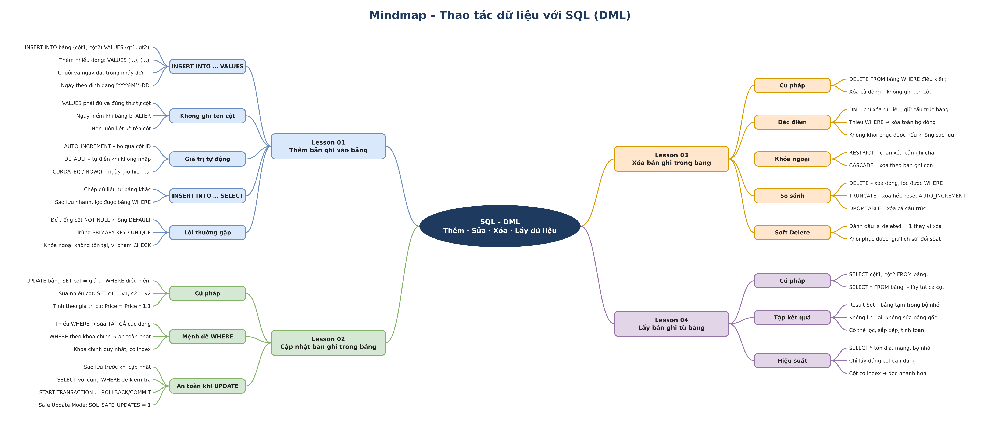

# Hệ thống kiến thức Mindmap: SQL – Thao tác dữ liệu (DML)

Mindmap tổng hợp kiến thức của 4 bài học trong Session, đi từ tổng quan đến chi tiết:

1. **Bài 1:** Thêm bản ghi vào bảng
2. **Bài 2:** Cập nhật bản ghi trong bảng
3. **Bài 3:** Xóa bản ghi trong bảng
4. **Bài 4:** Lấy bản ghi từ bảng

[Xem mindmap tương tác trên draw.io](https://www.draw.io/?title=mindmap-sql-dml.drawio#R7Z1dd9q6EoZ%2FDZftsiR%2F6dIY0maVkBbI6elVlwsOeIXY2cS0zfn1W5I%2FkCxBm5502iW8bzYWJgVrHmlezWg0IPH99ze75GFzVazS7QA7q%2B8DMhpgjFzHYf%2FjLU9VC20a1rtsVTVJDfPsf2n9yaZ1n63Sx7qtaiqLYltmD2rjssjzdFkqbcluV3xTb7sttiul4SFZp8rX4A3zZbJNtds%2BZqtyU7f6jnT72zRbb5p%2FGjfv3CfN3XXD4yZZFd%2BkJjIekHhXFGX16v57nG7501MfzMWRd9tvtkvz8mc%2BkJPqE1%2BT7b7%2BdfMPE9YwGONB6Awoe98ZXbEWf4DJ92RAhovNICaDKLrnd8V4MAzYi%2FlgjAbD4SAaJXLzf%2FmtQ6K0TcSt0SDynrgNNB%2B8YBfbrL4Kg339fMqn5qmzL846mF0Mv22yMp0%2FJEv%2BzjdmY6xtU95v2RViL2%2Bz7TYutsVOfI6gW5J4t7y9yEup%2FVb8x9ofy11xlx77RG1%2ByG%2Bu62%2FE%2F6X62aW7Mv1%2BtANQ260MiLS4T8sd%2F%2BH1B14h6ryujaHGgYRe0%2FLtYF4krNs2smU1hpXUJr1u%2F4FDp7MXdb8fsQFXs4FJ%2BvhY5KzNQUd6%2FkvTi4Tftt5k%2FA%2BIt51CfXut9eSu2OerdFU%2FxOf15ipJw9ulqdf8ZZh%2B6faaa%2Bi16pMNufiF%2BtFzu%2F3IRgRDP%2BLA0I%2F%2BS3SjpyOzYuNWfcl%2BR1Y%2BzdJtUmZFPj68M1zud1%2Fb3kjzVcSHSHaZF3mq9oX%2B5I73QvVl%2BDc4%2FUTZFy72u2WqjkdlslunpWyf%2BpPfid%2FyVf37%2F9cT9DUQLqfz8WzB2i6ni%2BvDsBixO53%2FRJOb8fxPWjf5TWNSEHZt%2BWDckikj05BE3BfoiMAGU3YNpuxDmXL4Q1NWh2jWk%2BGynn0pLdlXiLkHdWhhf41KRs%2FvXze3rat3mycldRszwlJ98Mk2W%2Bfs9a4ymSG31Iz5VlHdfp%2BtVttjs7xs%2FHqf1b0sM1U3PbI%2Fk%2BXrSXrLO8I9tMxqw3VfajZH2jRgIodgAzn4JcihNpDjG8gJochpVIaEjuz45JvWSUV74cByFxczhkjU4eP169cCmli57CkxUUJgMUHIVk6QAwYK1kCJN%2FtmxggkRcCxWVcvn4QUdAcU1dPPMCj5T9gVYhbKK9KQdFvss%2BtcICSUCA7EA%2Btc9kR1ifKBiSLWEoXBiNKV%2BFTiptykhYoPm4SGDJlmGSXipKw7bHxi%2F726uno1GvXEnCaGAhPjWUsMmGJHumR%2FJ6aQoStAqBamysp9y1VFcx7KHXkBqHRH1mp3BCbeka7eW13xsGl1e9adDKJA8bkaB4rREAkayk1zIxVUVBdD9AMu%2BqkBI4Jh5wYrdDwyTg5gSh47Bndqz%2F%2Btg4YnXNPfiVmisyD2pfWw2EU0WYxnPRgGMHxYMDCyFgwMptyxrtynBxdpu68dKDUiy2X6XXXXz7tUPSEYUWBCiL2EgClxrCvxN1m1NCVWq%2BS5QfGjFH%2BM0j8b%2FYZTGdijoCoDe7aqDAymnbGunaObxfXny2k8G1%2BNp4tOGlDrEPFUnX%2F2SXfody5H%2Ffivj%2F%2FM4GHHfysEODayAabAsa7AR%2BOL6GbShcIw%2BB%2Fig3mrLe7kRam8lfCjh54YAzE%2BMDHUXmLAxDbRxXZ8MxtFi%2FGAfwkqohJ85phefzy0SCTJEcJ1wxAdKWo9yFvkeKwj6%2Bkx0ENh6SHIWnoImCIn%2BFmph%2FPxZBwvzkNaENcHlRaE2CotCJh8Jq4hNUQM7%2FThdNJ%2F61BFQ31J9q7ODln2474hg4r4sOO%2BHfnm2AQKmAYnugafJzzJY8vznobOXsiFhOd4xKK1RmW0VBKkhk5DDVlK2AyrbJCPb8ezcY%2BMARkfGJnAXmTApDnRpflESTpkv1xGgo6qTJA23%2FDhTLZsEALrN1Fr%2FSYwEe3qIloM8k4brpajD7Qa3tVF2Ok11wzTm8mku%2BzULmD1E4G%2BvSkEnQhcKzRzMxKrm%2FXANLOra%2BbFTti7CLs572eXV9HsE3v1bvypXX66mV5%2BuOm9IRMEBBgCYi8EYErbdY8lwIpd9%2Fm6kFdL1QmhkdqUaMuqXGx8zZR0Q8QzpeK34%2FhdD48BHh8YHs9eeMDUt%2BufqHyApcoHsRywk%2BN35ZFSCM1%2Bpt9XB8FLw5Vr6pMQf2G69i%2Bqg%2BCHCLQOgvtXqOy2G16yEAKYyHZ1kR1XieTVnCCWYR%2F%2BpEXDCWkvgN1B4VIb7Nc1JfC5YEra05X0zfsqGt2NKszHC01Fi0%2FwMLQ55a9eUdUSPvhy7Z0cre432pmcJc%2BDTYn1kBVEmZwlD0xue7rcVqt%2BdSsjyESJ2gg1aKjl62tTZgQfmnAPjAGYEBgYYi8wYNLc06X5QswnI7Flu97NfXSOWQ5ij2%2FUE%2Bi832XsZzWQtFeYv4deo54ZQ%2F0DBMyMZy8zYIrc0xX51cGd2mjVD9DR8LaVUsQPYLdZeIG1UsQD09JeaCgolTXh6Iu9rCd4jp8%2FoOInKM7VotEsLveh2vUoXE0UdVKUVIyqnxD0CcGDTYz1rNDxnhEeMB3v6zq%2BgaV2oO6kcMdyIzlYMkyJiHAUVYZ5rqzhev2uVRMsISwsPrIWFh9Movv4ZDBQoWMlCiGoGMTNbDLkeSYZ85%2B%2B92zobAQImA1iLxtgatzX1XjUnRSqvXrNOvE5CIqAwm6u8D1rBYUPV6b8J5LG2VqSkgQ7XLb2vTwRzO4He40QDzZH3LdCcvvG4udgktvXJXezZY7VR2uQyFp3h8r7JDpLTESJ6Yl6UeUu6VExoBICo0LtRQVMYAe6wJ4vIrHxdDGLpvMoXlxeTzv7T2fXk8kw4pmAF%2FH11dVln1RuwCFEsDgEyFocAjAJHRii3MktD7bdPKySkr%2FgB5rVAe0Pk8%2Fz6GL8uZIM8zZA1wfkTDy4wDwQe3kAk83BqcPBiJQiKx319kcSYm9vU39p3Ie3CugXdk7aH0qIZXmu3QIdLuy5YMFfobnbXnjBfNgATHIHPng%2B7DMN%2BjetGbFDLbvDuAd7FFhgg%2FUGxlEcTA8HpnJmk7HIhr2YXV%2FpSbG%2FJ8N1K%2FwOu1ydEOtLRrB%2BDrWCENOaagAmg0NdBkseTbtkStQkC6WA2d0vHzxx7sAgB5aYEFlLTAimlEN8qlYBL7Sx1OcPvnx6Bj4SCjCokxQSa52kEEzqhrrU5Sefi5WeZXNySkhFv7czw4lSZrFcyFK8304jXhOi4wpi%2BSNZfPbTgxvATg9WCObQVKYpBFPMof9LWa8SWnJmxpfWe%2FrFLNczISUAJiWwlxS4o7rD02fYNbpCKsfB5hPvZAXAXAFNUSaPnVSRHiF1ddYBRojaixCYeqfOc6rgnIEAgT6PhSJrBQgFU9RUV9Sz8Xwxu4y7p04sN63IzlWnyRR7W26SfpjXgnAUdJinVij0ZpxVAQFT6NRQVjyax9Fo3OFDVhHVLiEjFzyK3XOhchEAc%2BHZywWY1qaGhPBCbCEVcWm%2B3%2BcMfB7ogyKovZFpCiZ%2B6YnI9JERXVr%2BeUZN%2FOcWwT%2BP4Z5gBDvcW6F2qSnyRsHULnJ0ubuY3Uzj6BQ2rWS4qHd67tLHlNc66x762COiIuLBIoIcZC0jteXCQKKr6dHs%2Bj3f1xANJydAUZI9jobsekpUSkJoSojFlGA4SlyDdLjl08Io3aZ8v8MZKAfoo1JYvpO10qG2KBjj9Y%2BlILW6t07QaAbw7PHzStj1St6rwxaJkiexNZR%2FLlamg36cV1HBBHict0Jlt%2BNshxUfjpXjUeZnBJb1nKZWfg%2BXG6VqWXWzspeaijMoHqu8DtTnwWpwedBwUZvhghPkyDmxS86VdslN2tno6dhGuePnn76gJ5YiVpImMHUG9QOS%2BH%2FPbjmfwO6WQ%2BivkN9tN7zgdrnaTGGIwOAb5p5p02DqwnNhz49AiNhgwe2g2rFhOG2M3ONVZKTtPE0R%2B0MLPrKtrt8rp7k8HoFNt0PIswMObIQDTnsj%2FzgcVV36YwQo665bxSEq5WqUpoXYfv%2BcESIfGqLAZojgRDkylAZXqvPdyUE755%2B9RMQZeE4%2BcYE9J2qz5wSnh7Guh2fp437LjXgugs7yHNApPVAqJ46qhWPqHUD5pi3i108GXWgc2Aw%2BhJEd0JhOPqktGQYafHofkFTddds9q1fd4aOcHNGha92uxfZBbH2%2BgUaH2IwOnFLH7pHVJiKCe3IpVyVdMG5pYXxcPAjbaByuh%2BrtUj6yq45c9GnjGjk%2BNDmezeTAyXisy%2Fi3ShUD53F%2F4qQUG1VHQGDzyBEOLFYdGE5N4%2FBHS1Jl6%2FzkUpDbZccsJtVof986Vk16ea87frbqGQLOAMR2iHVsTAHEcGKd6GI9VsrdqGu0DTU8licUhXpydrtoK3amrg7l9XtcVFxcYFwIshgXAifTiSmyrRLQOUFLKXCjHi4h9izlm0TIiw0X%2BL26MLASQLNCbGblN%2BlydrkrilJ67w0zuA0vl8%2Fv%2BBc%3D)

## Nội dung chi tiết

### Bài 1 · Thêm bản ghi vào bảng

- INSERT INTO … VALUES
  * INSERT INTO bảng (cột1, cột2) VALUES (gt1, gt2);
  * Thêm nhiều dòng một lần: VALUES (...), (...);
  * Chuỗi và ngày tháng đặt trong nháy đơn ' '
  * Ngày theo định dạng 'YYYY-MM-DD'
- Không ghi tên cột
  * Giá trị trong VALUES phải đủ và đúng thứ tự các cột của bảng
  * Nguy hiểm khi bảng bị ALTER: lỗi số cột hoặc ghi nhầm cột
  * Nên luôn liệt kê tên cột
- Giá trị tự động
  * AUTO_INCREMENT: bỏ qua cột ID, MySQL tự sinh
  * DEFAULT: tự điền khi không nhập
  * CURDATE() / NOW(): lấy ngày giờ hiện tại
- INSERT INTO … SELECT
  * Chép dữ liệu từ bảng khác bằng một câu lệnh
  * Sao lưu nhanh, lọc được bằng WHERE
- Lỗi thường gặp
  * Để trống cột NOT NULL không có DEFAULT
  * Trùng PRIMARY KEY / UNIQUE
  * Khóa ngoại không tồn tại, vi phạm CHECK

### Bài 2 · Cập nhật bản ghi trong bảng

- Cú pháp
  * UPDATE bảng SET cột = giá trị WHERE điều kiện;
  * Sửa nhiều cột: SET c1 = v1, c2 = v2
  * Tính theo giá trị cũ: Price = Price * 1.1
- Mệnh đề WHERE
  * Thiếu WHERE thì sửa tất cả các dòng
  * WHERE theo khóa chính là an toàn nhất
  * Khóa chính duy nhất, không NULL, có index
- An toàn khi UPDATE
  * Sao lưu trước khi cập nhật
  * Chạy SELECT với cùng điều kiện WHERE để kiểm tra
  * START TRANSACTION … ROLLBACK / COMMIT
  * Bật Safe Update Mode: SET SQL_SAFE_UPDATES = 1

### Bài 3 · Xóa bản ghi trong bảng

- Cú pháp
  * DELETE FROM bảng WHERE điều kiện;
  * Xóa cả dòng, không ghi tên cột
- Đặc điểm
  * Là lệnh DML: chỉ xóa dữ liệu, giữ nguyên cấu trúc bảng
  * Thiếu WHERE thì xóa toàn bộ các dòng
  * Không khôi phục được nếu không có bản sao lưu
- Khóa ngoại
  * RESTRICT: chặn xóa bản ghi cha đang được tham chiếu
  * CASCADE: xóa theo các bản ghi con
- So sánh
  * DELETE: xóa từng dòng, lọc được bằng WHERE
  * TRUNCATE: xóa hết các dòng, reset AUTO_INCREMENT
  * DROP TABLE: xóa cả cấu trúc lẫn dữ liệu
- Soft Delete
  * Đánh dấu is_deleted = 1 thay vì xóa thật
  * Khôi phục được, giữ lịch sử, phục vụ đối soát

### Bài 4 · Lấy bản ghi từ bảng

- Cú pháp
  * SELECT cột1, cột2 FROM bảng;
  * SELECT * FROM bảng; lấy tất cả các cột
- Tập kết quả (Result Set)
  * Bảng tạm thời trong bộ nhớ
  * Không được lưu lại, không làm thay đổi bảng gốc
  * Có thể lọc, sắp xếp, tính toán
- Hiệu suất
  * SELECT * tốn đọc đĩa, băng thông mạng và bộ nhớ
  * Chỉ lấy đúng những cột cần dùng
  * Cột có index thì đọc nhanh hơn
